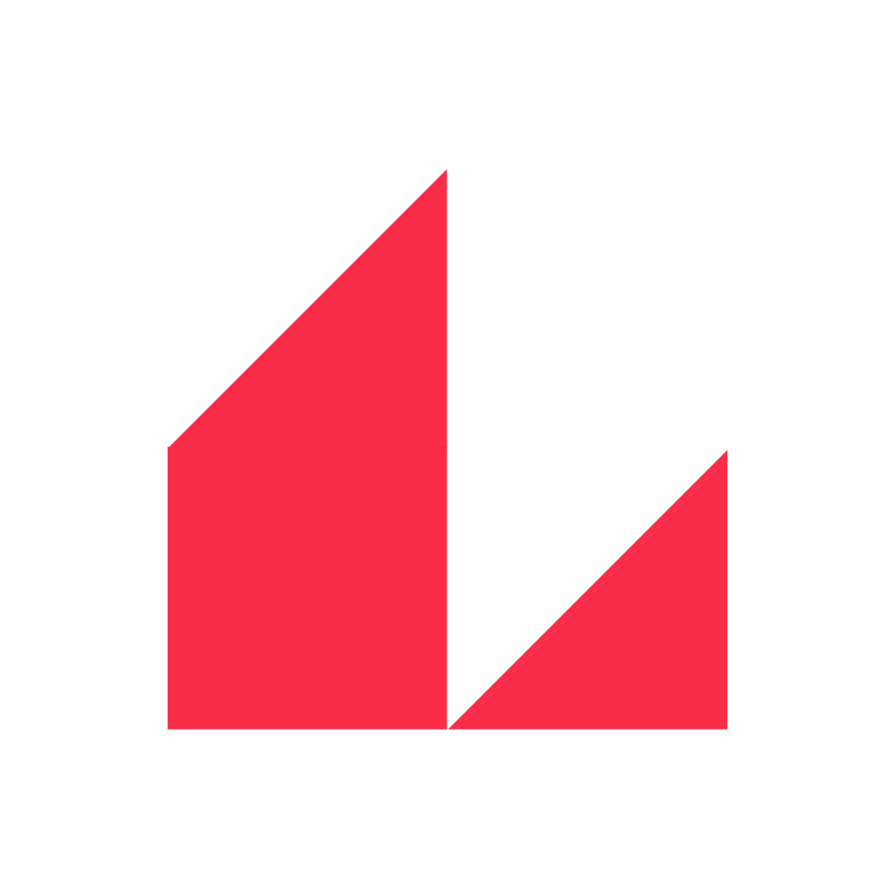

<div align="center">



# NaviTunes

**Apple Music for your own server, on iPhone and iPad.**  
Jellyfin or Navidrome. Your files, your library, no streaming subscription.


[Jump](#what-you-get) · [Servers](#servers) · [Magic playlist](#the-magic-playlist) · [iPad](#iphone-and-ipad) · [Run](#run-it)

</div>

---

## Servers

<table>
<tr>
<td width="50%" valign="top">

**🪼 Jellyfin** · ready

Sign in with URL, username, and password. Favorites, playlists, lyrics, and downloads all use the Jellyfin API directly. Your library syncs through a hidden playlist on the server.

</td>
<td width="50%" valign="top">

**🎵 Navidrome** · ready

Speaks the Subsonic API with salted-token auth. Adds per-item favorite dates, share links, internet radio stations from your server, and scan control.

</td>
</tr>
</table>

Credentials stay in the Keychain. HTTP works on a local network; HTTPS is recommended anywhere else.

---

## The magic playlist

This is what makes NaviTunes different from a normal server client.

When you add a song or album, it goes into a hidden playlist on your server. That playlist is your personal library. It syncs across your devices, keeps track of what you actually added (not just everything sitting on the server), and remembers when you added each item.

On a shared box your library stays separate from everyone else's. You never manage the playlist by hand: NaviTunes creates it, keeps it out of your playlist list, and updates it when you tap **Add to Library**.

---

## What you get

<table>
<tr>
<td width="33%" valign="top">

### 🏠 Home

Top Picks, New Releases, Recently Played, Made for You mixes, and genre rows. Built to surface music on your server that you have not added yet. Pull to refresh re-ranks it.

</td>
<td width="33%" valign="top">

### ✨ New

A browse tab for new releases and artist pages, ranked against your listening. With Lidarr connected it also folds in upcoming and wanted releases.

</td>
<td width="33%" valign="top">

### 📻 Radio

About 57,000 community stations from [Radio Browser](https://www.radio-browser.info), by genre, country, or search. Save favorites to Your Stations. Also your own stream URLs and the stations on your Navidrome server. No sign-in needed.

</td>
</tr>
<tr>
<td width="33%" valign="top">

### 📚 Library

Recently Added, artists, albums, songs, genres, playlists, favorites, and downloads. Big artwork, colors taken from the cover, and the layouts Apple Music users already know.

</td>
<td width="33%" valign="top">

### 🔎 Search

**Library** searches what you added. **Discover** searches the whole server, plus music not on it yet when a request plugin is connected, plus artists you can follow or request.

</td>
<td width="33%" valign="top">

### ▶️ Playback

Queue, shuffle, repeat, play next, synced lyrics, sleep timer, speed, lock-screen controls, and a mini player that opens into Now Playing. AutoMix crossfades between tracks.

</td>
</tr>
<tr>
<td width="33%" valign="top">

### 🎚️ Equalizer

Ten bands with presets. It works on downloads and cached streams, so turning it on also turns on stream caching.

</td>
<td width="33%" valign="top">

### ⬇️ Offline

Download albums, playlists, or favorites. Switch offline mode on by hand. Cellular streaming can be switched off, so only downloads and cached songs play.

</td>
<td width="33%" valign="top">

### 🧩 Widgets

Home screen widgets for recently played music and Made for You mixes.

</td>
</tr>
<tr>
<td width="33%" valign="top">

### 📥 Requests

Ask for missing music through **Lidarr** (albums), **Downtify** (single tracks), or **DroppedNeedle** (albums). One plugin is active at a time.

</td>
<td width="33%" valign="top">

### 🔔 Following

Follow an artist to keep their discography complete. NaviTunes compares the plugin's catalog with your server and requests what is missing. Without a plugin it works as a wishlist.

</td>
<td width="33%" valign="top">

### ⚙️ Settings

Account, library stats, streaming and download quality, equalizer, accent color, app icon, which tabs sit in the dock and the page the app opens to, scrobbling to your server, and plugins.

</td>
</tr>
</table>

---

## iPhone and iPad

| | iPhone | iPad |
| :--- | :---: | :---: |
| Home, New, Radio, Library, Search | ✅ | ✅ |
| Magic playlist and Add to Library | ✅ | ✅ |
| Downloads and offline mode | ✅ | ✅ |
| Equalizer, lyrics, AutoMix | ✅ | ✅ |
| Widgets | ✅ | ✅ |
| Tab bar at the bottom | ✅ | — |
| Tabs in a capsule at the top | — | ✅ |
| Sidebar with Library and Playlists | — | ✅ |
| Edit to reorder and hide tabs | ✅ | ✅ |
| Two-pane Now Playing with queue or lyrics | — | ✅ |
| Floating mini player | — | ✅ |

On iPad the tabs sit in a capsule at the top, and a liquid glass sidebar holds your Library pages and playlists, with **Edit** to reorder and hide them. The sidebar tints with your accent color. Grids fit the width of the page, so the sidebar opening gives you a column fewer. Now Playing keeps the player in the center, or moves it to the left with the queue or lyrics beside it. The mini player is a floating capsule with full transport controls. Artist pages put the latest release next to Top Songs, and album pages put the cover on the left with details and buttons beside it.

---

## Run it

<table>
<tr>
<td width="50%" valign="top">

### 🍎 Xcode

1. Open `NaviTunesHost/NaviTunesHost.xcodeproj`
2. Pick a simulator or a signed-in device
3. Run

Open the Xcode project, not `Package.swift` on its own. Running both at once can confuse Swift Package Manager.

</td>
<td width="50%" valign="top">

### ⌨️ Command line

```bash
xcodebuild \
  -workspace NaviTunesHost/NaviTunesHost.xcodeproj/project.xcworkspace \
  -scheme NaviTunesHost \
  -destination 'generic/platform=iOS Simulator' build
```

Tests run on a simulator through the `NaviTunesKitTests` scheme; see [CONTRIBUTING](CONTRIBUTING.md).

</td>
</tr>
</table>

**Needs:** Xcode 16 or later, iOS 26, and a Jellyfin or Navidrome server the device can reach.

**Bundle ID:** the app keeps the bundle ID and app group from before the rename (`com.randll.vellum`), so an existing install and its data carry over. Sign with your own team and set `NAVITUNES_BUNDLE_ID` in `NaviTunesHost/Config/Signing.xcconfig` if you need a different ID.

---

## Not in this build

🛒 **App Store** — build it from source in Xcode for now.

---

## License

No license file yet. All rights reserved unless stated otherwise.

---

<div align="center">

Made by [rndllb](https://github.com/rndllb) · [Contributing](CONTRIBUTING.md)

</div>
